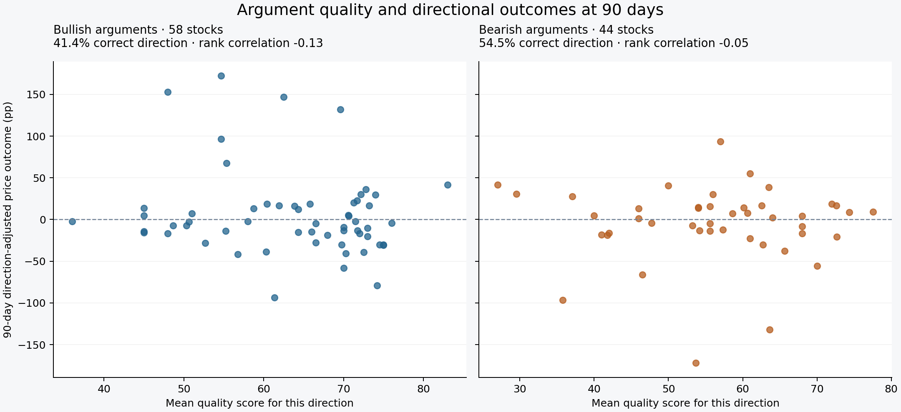
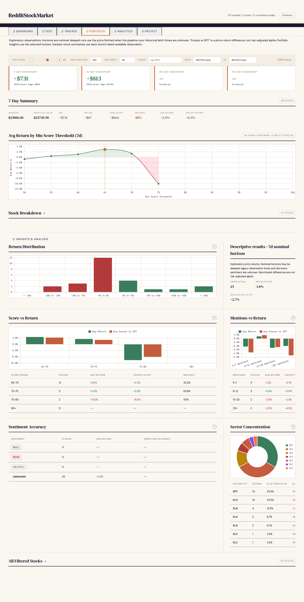

# Reddit Investment Thesis Analyzer

**Do better-supported investment arguments correspond to stronger subsequent stock returns?**

I built this project to investigate that question using financial discussions on Reddit. It collects posts and comments, uses LLMs to assess the argument for each stock, and tracks price returns alongside market and sector benchmarks.

## Historical results

I reconstructed **738 assessments available at discovery** and evaluated bullish and bearish arguments separately across **67 stocks**. At 90 days, bullish arguments matched the price direction for **24 of 58 stocks**, and bearish arguments for **24 of 44**. Higher argument-quality scores did not correspond to better directional outcomes within either group at that horizon.



The [directional results and interactive explorer](docs/directional-results.md) include absolute and SPY-relative comparisons, all selected horizons, reconstruction checks, and per-stock outcomes. The [raw stock-return report](docs/historical-results.md) provides additional market context. These are exploratory findings from a small selected sample, not a validated predictive signal.

## Recorded usage

| Measure | Database snapshot |
|---|---:|
| Collected posts and comments | **35,714** |
| Investing communities represented | **8** |
| Per-stock argument assessments | **7,632**, from 5,960 source items |
| Distinct tracked stocks | **67** |
| Recorded nominal 7-day / 14-day observations | **62 / 50** |
| Reconstructed 30-day / 90-day outcomes | **67 / 67** |

Scoring records span 12 March–4 April 2026. Some source posts are older. Nine communities are configured; eight are represented in this snapshot. Several assessments can come from the same post, and repeated discussion of a stock does not create independent investment outcomes.

The project demonstrates a working data pipeline and an exploratory research workflow. The small outcome sample and measurement limitations do not establish that the scores predict returns.

## Dashboard



The dashboard exposes argument scores, source discussions, tracked stocks, score-threshold comparisons, and market-relative returns. Portfolio insights use one selected nominal horizon. Threshold comparisons describe this sample; choosing the best threshold on these same outcomes does not validate a trading strategy.

## Engineering

- **Reddit collection:** public JSON endpoints, paced requests, a single retry after rate limiting, and deduplication by source ID.
- **Filtering before model calls:** explicit ticker symbols, company-name matching, ambiguity handling, and financial-context checks.
- **Per-stock LLM assessment:** separate reasoning, specificity, novelty, and credibility scores for each stock thesis in a post; sentiment and a short explanation accompany the scores.
- **Backend interchangeability:** Gemini, Anthropic, local Ollama, and a mock scorer. Gemini supports retries and a fallback model.
- **Persistence and orchestration:** SQLite with foreign keys and WAL mode; local scraping and manually dispatched GitHub Actions runs support analysis and tracking.
- **Inspection:** FastAPI, vanilla JavaScript, Chart.js, two dashboard themes, and Docker packaging.

The quality dimensions reflect model judgments about the text. They are not verified measurements of author expertise or factual accuracy.

```text
Reddit → ticker/context filter → per-stock LLM scores → SQLite
                                                         ↓
                      market prices + SPY + sector ETF tracking
                                                         ↓
                                         FastAPI dashboard
```

## Run locally

Python 3.10 or newer is required; 3.12 is used by the GitHub workflows and Docker image.

```sh
python -m venv .venv
# Activate .venv using the command for your shell.
python -m pip install -r requirements.txt
```

Copy `.env.example` to `.env` and supply the key for your chosen scoring provider. Backend selection and thresholds are in `config/settings.py`.

The dashboard can inspect the included database without model credentials. It opens the database read-only, so viewing leaves the published snapshot unchanged. "Latest day" counts and trailing windows end at the most recent data in the database rather than at today's date.

The ticker list used for symbol recognition is included as `data/tickers.csv`. `python scripts/download_tickers.py` replaces it with the current Nasdaq listing; this is only needed before scoring new text.

```sh
python main.py dashboard
python main.py scrape
python main.py analyze
python main.py track
```

Running `python main.py` executes all three pipeline stages. Model scoring can incur provider charges. Scraping retrieves the configured listings and eligible top-level comments; it does not enforce a 24-hour publication cutoff.

For experiments, set `DB_PATH` to a separate database path. Any pipeline stage (`scrape`, `analyze`, `track`) writes to the database, after which the evaluation scripts no longer accept it as the published snapshot; preserve the snapshot before running them against it.

The workflow in `.github/workflows/daily-pipeline.yml` runs only when manually dispatched from GitHub Actions. Configure the `GEMINI_API_KEY` repository secret first. It analyzes and tracks a working copy of the included database, then uploads that copy as a downloadable artifact retained for seven days. It has read-only repository permissions and does not commit results. Model scoring can incur provider charges.

The Windows helper `scripts/scrape_and_sync.bat` performs local collection and Git synchronization. Pushing data does not start analysis automatically; dispatch the workflow when needed. Neither helper deploys the dashboard or runs the test suite.

```sh
docker build -t reddit-thesis-analyzer .
docker run -p 8050:8050 reddit-thesis-analyzer
```

```sh
python -m pip install -r requirements-dev.txt
python -m pytest tests -q
```

## Measurement boundaries

- **Discovery information:** quality score and mention count are stored at discovery. An explicit sentiment snapshot is unavailable in the included sample; the directional report reconstructs the underlying seven-day assessment window and verifies its saved aggregates. Later assessments are excluded.
- **Dashboard checkpoint timing:** horizons are nominal calendar-day thresholds. The observation timestamp records the UTC time at which the quote fetch completed; this is not the exchange quote timestamp. Delayed runs may observe a later price, and several overdue horizons may share one run. Fetch times are unavailable in the included sample.
- **Comparisons:** stock/benchmark comparisons require both prices. Portfolio insights use one selected nominal horizon, while tracked-stock summaries explicitly show latest available observations across mixed horizons. Score grouping uses the score saved for each discovery, with one observation per discovery.
- **Return definition:** price changes exclude trading costs and do not constitute a total-return backtest. “Excess vs SPY” is a simple difference in percentage-point returns, not risk-adjusted alpha.
- **Inference:** the sample is selected by mention and quality thresholds; discussions and stock returns are correlated. Model/prompt versions and historical settings are not recorded per assessment. No p-values or significance claims are reported.

These constraints are part of interpreting the experiment, not evidence for or against the hypothesis. See [measurement and data notes](docs/methodology.md).

## Verification

The suite contains **158 tests** covering collection, scoring, persistence, tracking, API routes, and evaluation behavior, and runs in GitHub Actions on pushes and pull requests. External services are mocked so the suite can run without provider credentials. Model quality and live service availability require separate evaluation.
