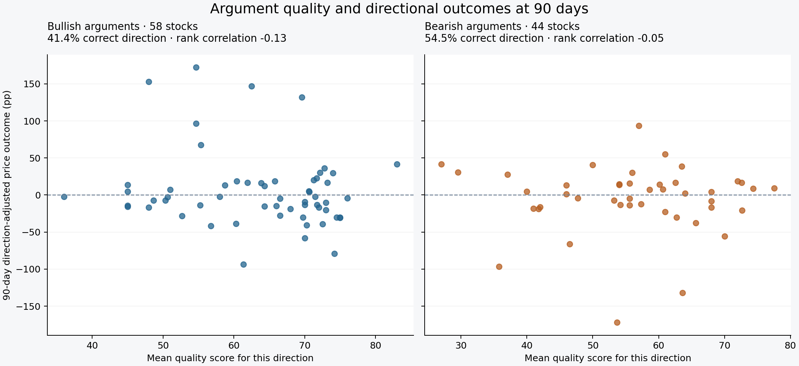

# Argument quality and directional outcomes

**At 90 days, bullish arguments got the price direction right for 24 of 58 stocks; bearish arguments did so for 24 of 44. Higher quality scores were not associated with better directional outcomes in either group at that horizon.**



The [interactive explorer](results/2026-09-13/directional.html) separates bullish, bearish, and combined views, with absolute and SPY-relative outcomes at any elapsed-day checkpoint. Download and open the HTML file in a browser to use it offline.

## The 90-day comparison

| Arguments | Distinct stocks | Correct absolute direction | Correct direction relative to SPY | Quality–absolute outcome correlation | Quality–SPY-relative outcome correlation |
|---|---:|---:|---:|---:|---:|
| Bullish | 58 | 24 / 58 (41.4%) | 20 / 58 (34.5%) | −0.13 | −0.14 |
| Bearish | 44 | 24 / 44 (54.5%) | 28 / 44 (63.6%) | −0.05 | −0.05 |

There are **67 distinct stocks**, with both bullish and bearish arguments for **35**. The two rows overlap; they are not 102 independent stock outcomes. The percentages describe how often each side's direction matched the outcome. They do not, by themselves, show whether higher-quality arguments did better—that is the purpose of the correlations.

The combined comparison gives each stock equal total weight. Its quality–outcome rank correlations are **−0.09** for absolute direction and **−0.18** relative to SPY. Opposing directions for a mixed stock cancel in the combined mean, so I emphasize the separate bullish and bearish views rather than interpreting the pooled mean as a strategy result.

## Evidence available at discovery

I reconstruct the original tracker’s seven-day window using assessment timestamps, ending at each discovery. The window reproduces the saved **mention count and rounded average quality score for all 67 stocks**. It contains **738 assessment records**; later assessments and older records outside the window are excluded.

For each matched stock, I calculate a separate mean quality score for bullish and bearish assessments. Neutral assessments remain part of the aggregate reconstruction check but do not enter directional evaluation. A mismatch or unknown sentiment label prevents the discovery from entering the directional comparison.

The matching aggregates support this reconstruction; the original database did not persist an explicit list of assessment IDs per discovery. The [discovery audit](results/2026-09-13/discovery-audit.csv) and [assessment references](results/2026-09-13/discovery-evidence.csv) make the selected evidence inspectable without substituting a later consensus or overwriting the database.

## What “correct” means

- **Absolute:** a bullish argument is directionally correct if the stock rises; a bearish argument is directionally correct if it falls.
- **Relative to SPY:** a bullish argument is directionally correct if the stock outperforms SPY; a bearish argument is directionally correct if it underperforms SPY.
- **Zero:** an unchanged outcome is a tie and is not counted as correct.

The directional outcome equals the stock return (or excess return over SPY) for bullish arguments and its negative for bearish arguments. Units are percentage points. These signed outcomes are evaluation scores, **not simulated short-selling profits**: borrowing costs, execution constraints, dividends, and transaction costs are excluded.

Each stock contributes once within each direction, regardless of how many assessments it has. Combined summaries assign weight one to a stock with one directional group and one-half to each side of a stock with both. The combined correlation uses weighted midranks and weighted Pearson correlation of those ranks. No significance test treats the paired directions as independent observations.

## Other horizons

The 90-day interval provides complete stock coverage and a consistent comparison. All previously selected intervals remain available; I do not select a horizon based on which produces the most favorable result.

| Calendar days | Bullish quality–absolute outcome correlation | Bearish quality–absolute outcome correlation |
|---|---:|---:|
| 7 | +0.20 | −0.21 |
| 14 | +0.20 | −0.49 |
| 30 | −0.08 | −0.15 |
| 60 | −0.07 | +0.01 |
| 90 | −0.13 | −0.05 |
| 120 | −0.23 | −0.18 |
| 180 | −0.44 | −0.16 |

The early bullish correlations are mildly positive, but this pattern does not persist at longer horizons. These exploratory comparisons do not establish either a predictive signal or its absence in the broader population. Sample sizes and available stocks differ at longer horizons; [the full summary](results/2026-09-13/directional-summary.json) includes coverage for each direction and outcome.

## Interpretation limits

Sentiment and quality are **model-generated labels**. A bearish interpretation is not necessarily an explicit recommendation to short a stock, and some arguments are conditional or concern a different intended time horizon. No human-labeled validation set was used. Repeated assessments and shared sources do not provide independent price outcomes.

The sample is small and selected, historical thresholds varied, and stocks share sector and market exposure. There is no held-out validation sample. Reconstructing the seven-day window addresses future-information leakage but does not remove these limitations.

Prices retain the **13 September 2026 cutoff**, whose latest market session is 11 September. The original saved discovery prices, split normalization, ticker aliases, calendar rules, and NXXT data gap are documented in the [stock-price methodology](historical-results.md). The raw-return comparison remains useful context; it measures a different question from whether an argument got the direction right.

## Reproduce

After generating the historical price evaluation:

```sh
python scripts/evaluate_directions.py \
  --history-dir research/results --output-dir research/directional
```

The evaluator reads the database and frozen historical outputs, checks that their database hashes match, and writes separate reports. It does not fetch new prices, rescore text, or modify stored observations. The current historical explorer format supports one discovery per ticker; repeated ticker discoveries are rejected rather than merged.

The [per-stock directional checkpoints](results/2026-09-13/directional-checkpoints.csv), [summary](results/2026-09-13/directional-summary.json), and [provenance manifest](results/2026-09-13/directional-manifest.json) accompany the explorer.
