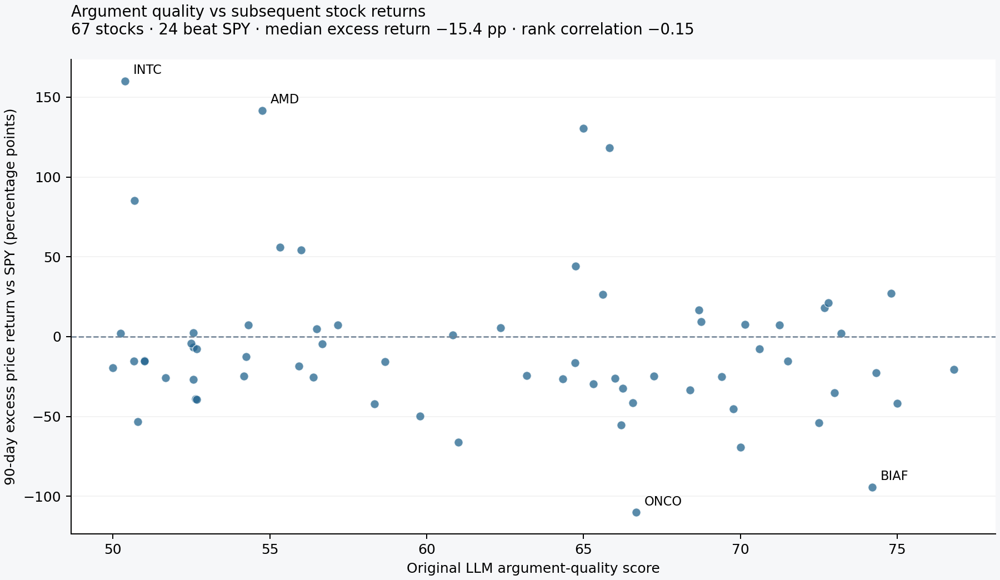

# Stock-price outcomes through 13 September 2026

**This report measures stock-price performance, irrespective of the arguments’ direction.** For the evaluation of bullish and bearish arguments, see [directional outcomes](directional-results.md). Among 67 tracked stocks, 24 outperformed SPY. The median stock lagged the benchmark by **15.4 percentage points**, and the rank correlation between quality score and excess return was **−0.15**.



The [interactive report](results/2026-09-13/results.html) lets you select any elapsed calendar-day checkpoint or the latest available common market date. Download and open the HTML file in a browser; it works offline. The [per-stock checkpoint table](results/2026-09-13/checkpoints.csv), [summary](results/2026-09-13/summary.json), and [data provenance manifest](results/2026-09-13/manifest.json) contain the underlying results.

| Interval after discovery | Paired stocks | Mean price return | Median price return | Median excess vs SPY | Stocks beating SPY | Score–excess rank correlation |
|---|---:|---:|---:|---:|---:|---:|
| 7 days | 67 | −0.8% | −2.0% | −0.3 pp | 32 | −0.01 |
| 14 days | 67 | −4.1% | −5.4% | −2.8 pp | 22 | −0.03 |
| 30 days | 67 | +0.5% | +2.4% | −3.3 pp | 26 | −0.15 |
| 60 days | 67 | +21.5% | +0.7% | −10.5 pp | 25 | −0.15 |
| 90 days | 67 | +6.2% | −2.6% | −15.4 pp | 24 | −0.15 |
| 120 days | 66 | +3.0% | −0.9% | −14.7 pp | 21 | −0.17 |
| 180 days | 42 | +6.7% | +3.5% | −11.6 pp | 13 | −0.26 |

The large difference between the 60-day mean and median shows how a few winners can dominate an average. I report both and retain every available outcome. The 180-day cohort is smaller because later discoveries have not reached an observable 180-day market session by the cutoff; it is not directly comparable to the full cohort.

Using the latest common session, **11 September 2026**, 19 of 66 stocks beat SPY, with median excess return **−13.6 pp**. This view mixes holding periods and is provided for inspection rather than a uniform-horizon score comparison.

## What is being measured

I compare each stock's saved discovery score with its subsequent price return. There is one outcome per tracked stock, not one independent outcome for every Reddit comment. The comparison uses the original discovery score and mention count, without incorporating later discussion.

Returns in this report are unsigned stock outcomes: a falling stock is not automatically counted as a failed bearish recommendation. The [directional report](directional-results.md) reconstructs the assessment window at discovery and evaluates bullish and bearish arguments separately.

These descriptive results do not support a positive score–return relationship in this sample. They also do not establish that argument quality has no value in general. There are only 67 selected stocks, scores are model judgments, stocks share market and sector exposure, and discovery dates and selection thresholds vary. The analysis has no held-out sample, and exploring many horizons or thresholds does not validate a trading strategy.

## Price and date conventions

1. **Entry:** the stock, SPY, and sector ETF quotes stored when the stock was discovered. SQLite discovery timestamps are interpreted as UTC and converted to the New York calendar date.
2. **Checkpoint:** discovery date plus the requested number of calendar days. A weekend or holiday rolls forward to the first available SPY session on or before the cutoff.
3. **Matched date:** the stock and benchmark must both have a valid close on that exact session. Missing stock prices are not carried forward, replaced with zero, or taken from a later session.
4. **Share basis:** Yahoo Finance daily `Close` is used with `auto_adjust=False`. Subsequent split ratios normalize the saved entry quote to the same share basis as the historical close. Splits before discovery are excluded; a split on the discovery date requires review. This also handles a split occurring after a particular checkpoint but already reflected in the downloaded historical prices.
5. **Return:** `100 × (historical close / normalized entry quote − 1)`. Excess return is stock return minus benchmark return, in percentage points. This is price performance, excluding dividends and transaction costs; it is not total return or risk-adjusted alpha. The separately cached adjusted close is not used. [Yahoo price-adjustment documentation](https://help.yahoo.com/kb/SLN28256.html).
6. **Intraday timing:** entry quotes and daily closing prices need not represent the same time of day. An exact executable entry price or historical bid–ask spread cannot be recovered from this snapshot.

The CSV also includes comparisons against each stock's stored sector ETF. Some stored choices use SPY as a fallback, so these should not be interpreted as a uniform sector-control design.

## Coverage and corporate actions

Two historical tickers require provider aliases: EVTV → AZIO from 13 July 2026 and GAMB → GRSD from 23 July 2026. Original discovery tickers remain in the results. The mappings are documented in [symbol-aliases.json](../data/symbol-aliases.json), with the companies' [AZIO announcement](https://www.sec.gov/Archives/edgar/data/1563568/000143774926023245/ex_986809.htm) and [Grandstand announcement](https://www.sec.gov/Archives/edgar/data/1839799/000183979926000128/exhibit991-pressreleasexgr.htm).

The cached NXXT series has no valid daily closes after 17 July 2026. Its 120-day and latest observations are excluded; this is a provider-data gap, not an assumed loss or delisting. The 7–90-day comparisons cover all 67 stocks. Missingness can still bias longer-horizon summaries.

The manifest records the evaluation cutoff, download timestamps, database hash, cache-file hashes, aliases, and evaluator-source hashes. The source database remains unchanged. Daily price caches are separate from the original tracking observations; the dashboard's saved quote checkpoints and this historical report have distinct timing conventions.

## Reproduce or choose another checkpoint

From the repository root, with dependencies installed:

```sh
python scripts/download_history.py --as-of 2026-09-13 --price-dir research/prices
python scripts/evaluate_history.py --as-of 2026-09-13 \
  --price-dir research/prices --days 7 14 30 60 90 120 180 \
  --output-dir research/results
```

Use a fresh price directory for each download snapshot. To inspect another interval, change `--days` (for example, `--days 45 100`) or use the number field in the generated HTML report. To advance the cutoff, download prices again and pass the same new date to both commands. The downloader excludes the current day's potentially unfinished session.

Both commands read the database without modifying it. Evaluation works offline against cached prices and requires no model calls. Provider history can be revised, so later downloads may not reproduce a frozen snapshot byte for byte.
